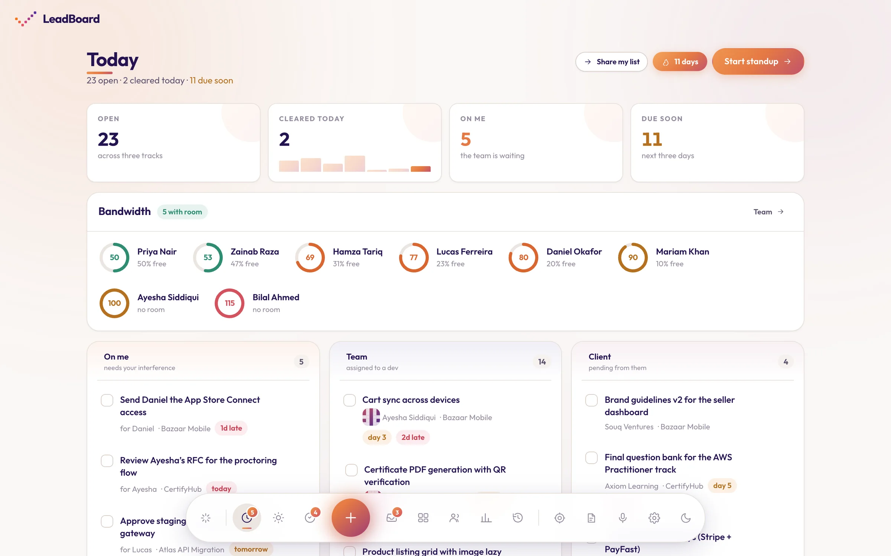
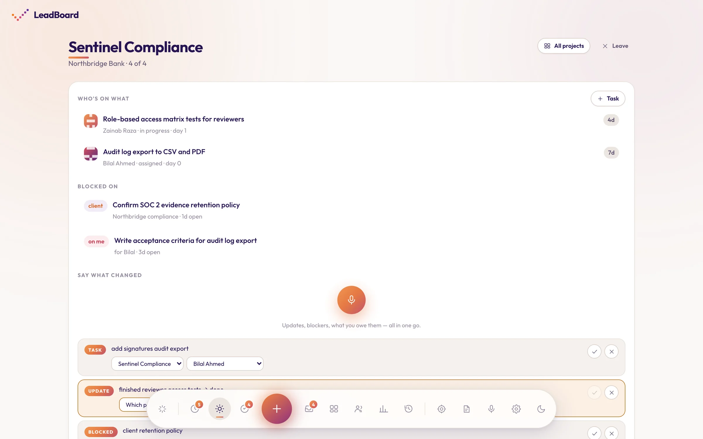
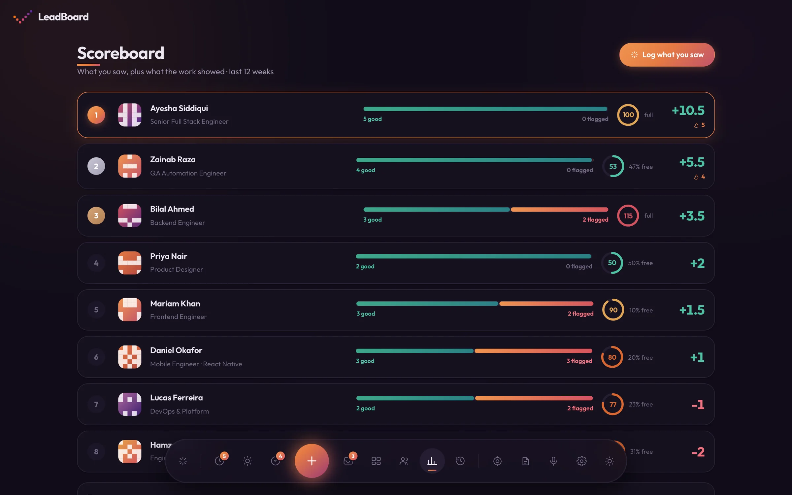
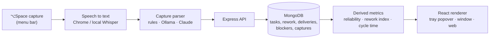

# Leadboard

A voice-first team lead cockpit that lives in the macOS menu bar, built for a lead
with ADHD.

Replaces the paper notebook: he talks, the system structures. The morning standup
becomes a five-minute guided ritual instead of a blank page. Dev performance —
rework, deliveries, deadlines — is derived from work that already happens, never
hand-maintained.

**[Live demo](https://leadboard-two.vercel.app)** · Electron · React 19 · Express · MongoDB



<table>
  <tr>
    <td></td>
    <td></td>
  </tr>
</table>

## Why I built it

The lead it's built for ran everything from a paper notebook: who's blocked, what was
promised to whom, which tasks keep coming back. Writing it down was the bottleneck.
Leadboard lets him say it out loud instead. A capture like *"Hamza's PR bounced again,
client changed the spec"* turns into a task update plus a rework event attributed to
the client, and the scoreboard updates itself.

## How it works



- **One renderer, three shells.** The same Vite bundle runs in the tray popover, the
  main window and a plain browser.
- **Nothing is hand-scored.** Every task transition is appended to history, and a reopen
  needs a one-tap reason. Reliability, rework and cycle time are all computed from those
  events (see [DATA-MODEL.md](docs/DATA-MODEL.md)).
- **Swappable providers.** Speech and parsing sit behind adapters, so it runs for free
  by default. Raw transcripts are kept, which means a bad parse can always be replayed.

## Layout

| Dir | What |
|---|---|
| `desktop/` | Electron main process — tray, popover, ⌥Space capture overlay, notifications |
| `fe/` | Vite + React 19 renderer. One bundle serves all three shells |
| `be/` | Express + MongoDB API — capture parsing, standup, registry |
| `docs/` | Approach, user flows, data model, shell decision, roadmap |

## Running it

Nothing here needs a paid account. The only thing you must supply is your MongoDB
connection string.

```bash
# 1. API — put your connection string in be/.env as MONGODB_URI=...
cd be && npm install && npm run seed && npm run dev

# 2. Renderer
cd fe && npm install && npm run dev

# 3. Desktop shell
cd desktop && npm install && npm run dev
```

The tray icon appears in the menu bar. `⌥Space` captures from anywhere,
`⌘⇧L` opens the main window. For a browser-only run, skip step 3 and open
`http://localhost:5180`.

### What costs nothing

| Piece | Default | Cost |
|---|---|---|
| Transcription | Chrome speech in the browser; local Whisper in the desktop app | free, no key |
| Capture parsing | rules-based, no model, no network | free, instant |
| Database | your MongoDB | your existing cluster |

Optional upgrades, all behind the same adapters and none required:

- `PARSER=ollama` — a free local model, better on messy run-on speech
- `PARSER=claude` / `STT_PROVIDER=whisper` — best quality, needs a paid key

Raw audio is retained regardless, so switching providers never costs history.

## Docs

- [docs/APPROACH.md](docs/APPROACH.md) — the product thinking
- [docs/DESKTOP.md](docs/DESKTOP.md) — why menu bar, why Electron, the speech constraint
- [docs/USERFLOWS.md](docs/USERFLOWS.md) — screen-by-screen flows
- [docs/DATA-MODEL.md](docs/DATA-MODEL.md) — collections and the scoring rules
- [docs/ROADMAP.md](docs/ROADMAP.md) — build phases
